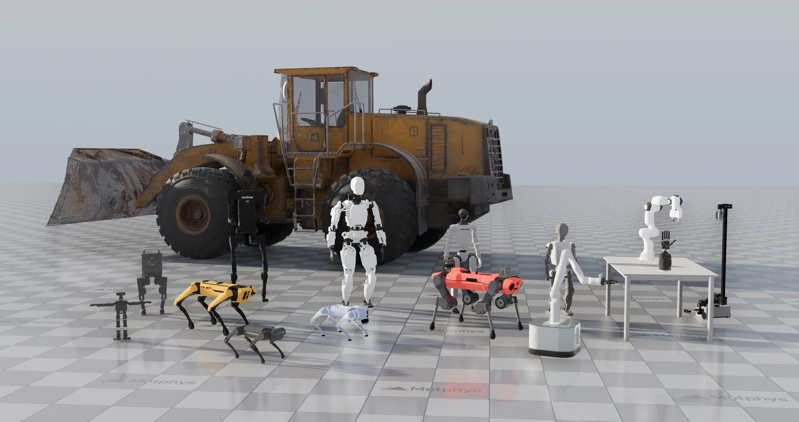
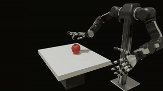
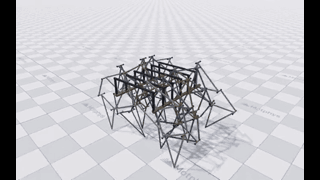
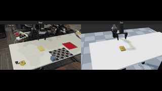
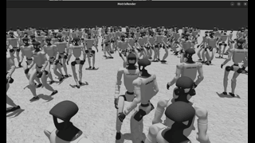
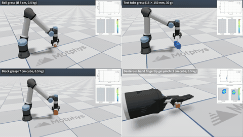
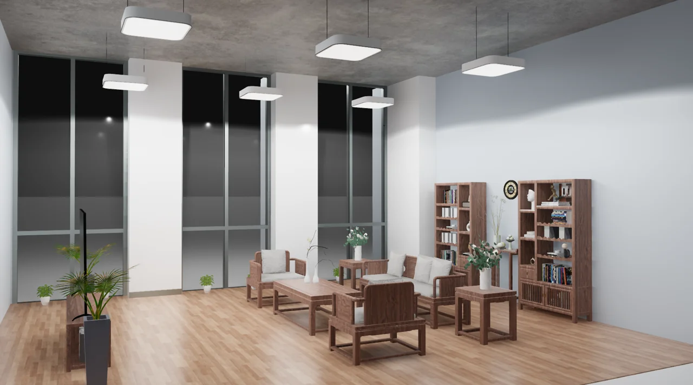
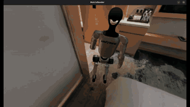
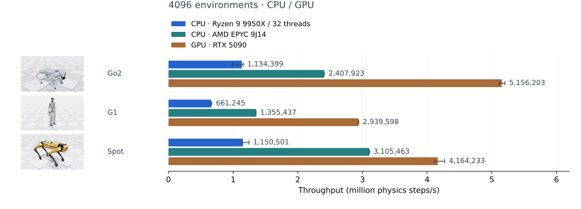

# MotrixSim

English | [简体中文](README.zh-CN.md)

[](https://pypi.org/project/motrixsim/)

[](LICENSE)

**A simulation engine combining fine-grained physical interaction with large-scale parallelism.**

MotrixSim integrates multibody dynamics, fine-grained contact, soft-body simulation, and CPU/GPU parallel computing, and provides visual and tactile observations. Through a unified physical scene and Python interface, it supports robot control, reinforcement learning, complex mechanism analysis, and embodied AI research. Technical details and full experiments are available in the [technical report](https://motrixsim.motphys.com).

[Documentation](https://motrixsim.readthedocs.io/en/latest/) · [Technical Report](https://motrixsim.motphys.com/en) · [Web Simulation](https://motrix.motphys.com)

https://github.com/user-attachments/assets/30bbd874-4567-4f4e-81ec-388d9a707308

<p align="center">
  
</p>
<p align="center"><em>Multibody systems in MotrixSim: humanoids, quadrupeds, robot arms, dexterous hands, and construction machinery.</em></p>

## Table of Contents

- [Core Features](#core-features)
- [Performance](#performance)
- [Quick Start](#quick-start)
  - [Option 1: Clone This Repository and Run Examples](#installation)
  - [Option 2: Install into an Existing Project](#python-example)
- [Featured Examples](#examples)
- [Supported Platforms](#platforms)
- [Ecosystem and Research](#ecosystem)
- [Community and Feedback](#community)
- [Repository Contents and License](#license)
- [Citation](#citation)

---

<a id="core-features"></a>

## Core Features

| Feature | Description | Demo |
| --- | --- | --- |
| SDF-based fine interaction | Uses **signed distance fields (SDF)** to represent complex curved and non-convex surfaces, with multi-point contact and friction solving, for interactions that depend on local geometry such as dexterous grasping and gear meshing. |  |
| Complex mechanisms and closed-loop constraints | Describes multibody systems in generalized coordinates and solves joints, limits, contacts, and closed-loop constraints jointly. The Strandbeest model drives **12 legs, 92 links, and 36 closed kinematic loops** from a single crank; the companion example supports constraint residual checks. |  |
| Soft bodies and rigid-soft coupling | Uses the **material point method (MPM)** to simulate compression, rebound, and large deformation, exchanging motion boundaries and contact reactions bidirectionally with multibody dynamics, as in a robot arm squeezing a sponge. |  |
| CPU/GPU massive parallelism | Provides **CPU/GPU batched simulation backends** with a Python interface for managing the state and control of whole batches, single environments, and environment subsets, supporting RL sampling, parameter sweeps, and policy evaluation. |  |
| Tactile sensing and force control | Computes the 3D displacement field on a gel surface from contact geometry via reduced-order contact solving, outputting marker displacements and normal deformation with batched computation. Gel contact forces can feed force-control loops for arm and dexterous-hand grasping. |  |
| High-quality PBR rendering | Describes materials via albedo, roughness, and metallic parameters, combined with environment lighting and screen-space global illumination (SSGI). Batched cameras output RGB, depth, and segmentation images for visual policy training. | <a href="assets/readme/pbr.webp"></a> |
| 3DGS hybrid rendering | Blends **3D Gaussian Splatting (3DGS)** with PBR meshes, combining scanned environment appearance with independently configured physical models. |  |

<a id="performance"></a>

## Performance

Physics stepping throughput with 4096 parallel environments (Go2, G1, and Spot; CPUs: Ryzen 9 9950X (32 threads) and AMD EPYC 9J14; GPU: RTX 5090; unit: million physics steps/s):

<p align="center">
  
</p>

---

<a id="quick-start"></a>

## Quick Start

Install [uv](https://docs.astral.sh/uv/getting-started/installation/) and [Git LFS](https://git-lfs.com/) first.

<a id="installation"></a>

### Option 1: Clone This Repository and Run Examples

The following installs the repository-pinned `motrixsim` SDK with example dependencies and runs the Spot scene, demonstrating model loading, physics stepping, and synchronized rendering.

**1. Clone the repository**

```bash
git lfs install
git clone https://github.com/Motphys/motrixsim.git
cd motrixsim
git lfs pull
```

**2. Install dependencies**

```bash
uv sync
```

**3. Run the first simulation**

From the repository root, this opens the Spot simulation window:

```bash
uv run python examples/getting_started/hello_motrixsim.py
```

<details>
<summary>macOS Apple Silicon: launch windowed examples with mxpython</summary>

Examples with a rendering window must be launched via `mxpython`:

```bash
uv run mxpython examples/getting_started/hello_motrixsim.py
```

</details>

The Spot simulation window opens and keeps stepping physics with synchronized rendering. The example uses default control inputs; policy execution is shown in the [robot control examples](examples/control/). A graphical display environment and Git LFS model assets are required.

<a id="python-example"></a>

### Option 2: Install into an Existing Project

If you already have a Python project, install the SDK directly without cloning this repository:

```bash
uv add motrixsim      # or pip install motrixsim
```

Load your own MJCF scene, create the state data, and step the simulation:

```python
import motrixsim as mx

model = mx.load_model("path/to/your_scene.xml")
with mx.render.RenderApp("warn") as render:
    render.launch(model)
    data = mx.SceneData(model)
    while True:
        model.step(data)
        render.sync(data)
```

For model loading and runtime configuration (including GPU requirements), see the [installation guide](https://motrixsim.readthedocs.io/en/latest/user_guide/getting_started/installation.html).

<a id="examples"></a>

## Featured Examples

Repository examples cover core simulation, complex mechanisms, batched environments, and robot control. Run them from the repository root with `uv run python <example path>`; on macOS, windowed examples use `mxpython` instead of `python`. See each example for extra configuration.

| Task | Example | Path | Description | Screenshot |
| --- | --- | --- | --- | --- |
| Complex mechanisms | [Strandbeest](examples/physics/strandbeest.py) | `examples/physics/strandbeest.py` | A multi-leg closed-chain mechanism driven by a single crank, with constraint error checks. |  |
| Batched simulation | [Parallel simulation](examples/parallel/parallelsim.py) | `examples/parallel/parallelsim.py` | State management, batched control, and visualization of 100 independent environments. |  |
| Locomotion policies | [robot_locomotion](examples/control/robot_locomotion.py) | `examples/control/robot_locomotion.py` | Keyboard-driven walking for G1, Go2, and other robots. |  |
| Sensor panels | [robot_locomotion](examples/control/robot_locomotion.py) | `examples/control/robot_locomotion.py --robot go2 --lidar ouster_os0_rev6_128ch_10hz_512res` or `--depth-camera` | Lidar point-cloud BEV panel and depth camera view. Use `--list-lidars` to list all lidar profiles (hesai_xt32, ouster_os0/os1/os2, and other channel/frequency combinations); depth camera is Go2-only. |  |
| Visual scenes | [G1 + 3DGS](examples/viewer/g1_3dgs_locomotion.py) | `examples/viewer/g1_3dgs_locomotion.py` | Robot locomotion and an onboard camera in a scanned environment; requires the corresponding rendering features and scene assets. |  |
| Viewer UI | [UI Gallery](examples/viewer/ui_gallery.py) | `examples/viewer/ui_gallery.py` | A tour of viewer panels, widgets, image display, and window lifecycle APIs. |  |

More examples: [getting started collection](examples/getting_started/), [physics collection](examples/physics/), and the [user guide and API docs](https://motrixsim.readthedocs.io/en/latest/).

<a id="platforms"></a>

## Supported Platforms

| Item | Support |
| --- | --- |
| Python | 3.10–3.13 |
| Linux | x86_64 |
| Windows | x86_64 |
| macOS | Apple Silicon (arm64) |

These are the CPU simulation ranges. GPU simulation and rendering features have additional requirements; see the [installation guide](https://motrixsim.readthedocs.io/en/latest/user_guide/getting_started/installation.html).

<a id="ecosystem"></a>

## Ecosystem and Research

The following projects use MotrixSim as the physics backend for robot RL, high-fidelity embodied simulation, and heterogeneous training systems.

**MotrixLab** (robot RL): environment registration, training configuration, RL framework adapters, evaluation, and replay for quadrupeds, humanoids, arms, and dexterous hands. [Repository](https://github.com/Motphys/MotrixLab) · [Documentation](https://motrixlab.readthedocs.io/)

**GS-Playground** (high-fidelity embodied simulation): developed by Tsinghua AIR DISCOVER Lab with Motphys and collaborators; combines MotrixSim parallel physics with 3DGS rendering for visual navigation, manipulation, locomotion, and Sim2Real research. Accepted at **RSS 2026**. [Repository](https://github.com/discoverse-dev/gs_playground) · [Paper](https://arxiv.org/abs/2604.25459) · [Project page](https://gsplayground.github.io/)

**UniLab** (heterogeneous simulation and learning): connects CPU simulation and GPU learning in a unified training runtime, using MotrixSim as the CPU-batched physics backend for large-scale sampling and cross-platform training. [Repository](https://github.com/unilabsim/UniLab) · [Paper](https://arxiv.org/abs/2605.30313)

<a id="community"></a>

## Community and Feedback

- [GitHub Issues](https://github.com/Motphys/motrixsim/issues): bug reports and feature requests.
- [GitHub Discussions](https://github.com/Motphys/motrixsim/discussions): usage questions and discussion.

<a id="license"></a>

## Repository Contents and License

This repository hosts the **documentation, examples, tests, and supporting assets**; the simulation runtime is distributed separately as the binary Python package `motrixsim`.

Repository code is licensed under [Apache-2.0](LICENSE). Third-party models and assets carry their own licenses; the runtime's terms are stated in the SDK notice.

[Tests](tests/) run via `uv run --with pytest pytest tests`; see the test configuration for extra dependencies and graphical environment requirements.

<a id="citation"></a>

## Citation

If you use MotrixSim in research, please cite:

```bibtex
@software{motrixsim2026,
  title  = {MotrixSim: A Physics Simulation Engine for Robotics and Embodied AI},
  author = {{Motphys Team}},
  year   = {2026},
  url    = {https://motrixsim.readthedocs.io/},
  note   = {Python binary package}
}
```
