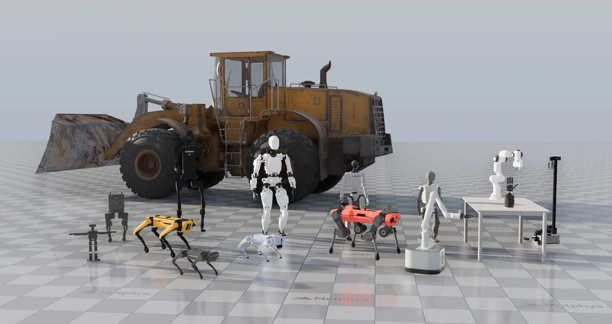
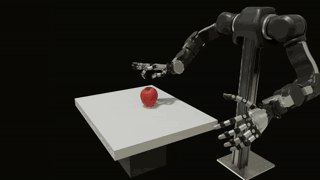
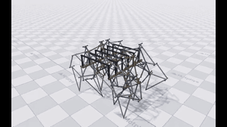
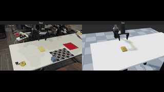
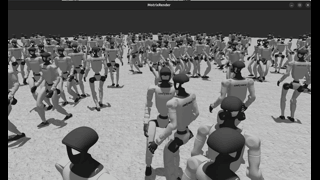
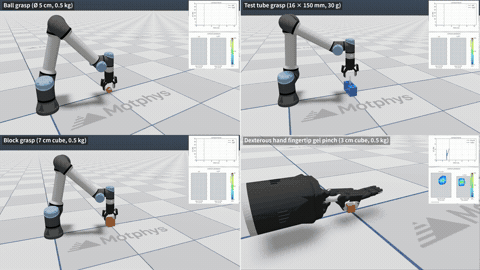
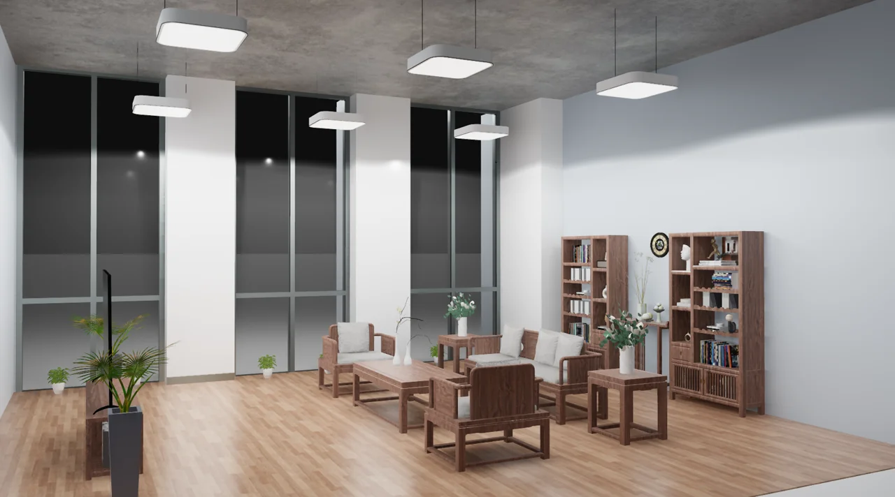
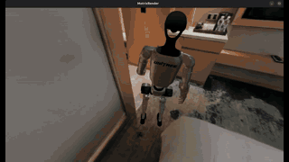
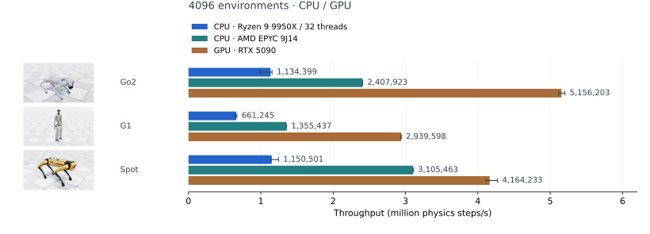

# MotrixSim

[English](README.md) | 简体中文

[](https://pypi.org/project/motrixsim/)

[](LICENSE)

**兼顾精细物理交互与大规模并行的仿真引擎。**

MotrixSim 集成多体动力学、精细接触、柔性体仿真与 CPU/GPU 并行计算，并提供视觉和触觉观测。通过统一的物理场景与 Python 接口，支持机器人控制、强化学习、复杂机构分析及具身智能研究。技术细节与完整实验见[技术报告](https://motrixsim.motphys.com)。

[阅读文档](https://motrixsim.readthedocs.io/zh-cn/latest/) · [技术报告](https://motrixsim.motphys.com) · [网页版仿真](https://motrix.motphys.com)

https://github.com/user-attachments/assets/30bbd874-4567-4f4e-81ec-388d9a707308

<p align="center">
  
</p>
<p align="center"><em>MotrixSim 中的多体系统：人形、四足、机械臂、灵巧手与工程机械。</em></p>

## 目录

- [核心特性](#core-features)
- [性能](#performance)
- [快速开始](#quick-start)
  - [方式一：克隆本仓库，运行示例](#installation)
  - [方式二：在已有项目中安装](#python-example)
- [精选示例](#examples)
- [支持的平台](#platforms)
- [生态与研究](#ecosystem)
- [交流与反馈](#community)
- [仓库内容与许可](#license)
- [引用](#citation)

---

<a id="core-features"></a>

## 核心特性

| 特性 | 说明 | 演示 |
| --- | --- | --- |
| SDF 精细交互 | 使用**有符号距离场（SDF）**表示复杂曲面与非凸结构，支持多点接触与摩擦求解，用于灵巧抓取、齿轮啮合等依赖局部几何细节的交互。 |  |
| 复杂机构与闭环约束 | 基于广义坐标描述多体系统，联合求解关节、限位、接触与闭环约束。Strandbeest 模型由同一曲柄驱动 **12 条腿、92 个连杆和 36 个闭合运动环路**，配套示例支持约束残差检查。 |  |
| 柔性体与刚柔耦合 | 使用**物质点法（MPM）**模拟压缩、回弹与大变形，并与多体动力学双向交换运动边界及接触反作用，描述机械臂夹取海绵等刚柔交互。 |  |
| CPU/GPU 大规模并行 | 提供 **CPU/GPU 批量仿真后端**，通过 Python 接口管理整批、单环境及环境子集的状态与控制，支持强化学习采样、参数扫描和策略评测。 |  |
| 触觉感知与力控 | 根据接触几何，通过降阶接触求解计算凝胶表面三维位移场，输出标记点（marker）位移与法向变形，并支持批量计算。凝胶接触力可接入力控闭环，用于机械臂与灵巧手抓取。 |  |
| PBR 高质量渲染 | 通过反射率、粗糙度与金属性描述材质，结合环境光照和屏幕空间全局光照（SSGI）计算光照响应。批量相机可输出彩色、深度与分割图像，用于视觉策略训练。 | <a href="assets/readme/pbr.webp"></a> |
| 3DGS 混合渲染 | **3D 高斯泼溅（3DGS）**与 PBR 网格混合渲染，融合扫描环境外观与独立配置的物理模型。 |  |

<a id="performance"></a>

## 性能

4096 个并行环境下的物理步进吞吐（Go2、G1 与 Spot；CPU 为 Ryzen 9 9950X（32 线程）和 AMD EPYC 9J14，GPU 为 RTX 5090；单位：百万物理步/秒）：

<p align="center">
  
</p>

---

<a id="quick-start"></a>

## 快速开始

请先安装 [uv](https://docs.astral.sh/uv/getting-started/installation/) 和 [Git LFS](https://git-lfs.com/)。

<a id="installation"></a>

### 方式一：克隆本仓库，运行示例

以下流程安装仓库锁定的 `motrixsim` SDK 与示例依赖，并运行 Spot 场景，展示模型加载、物理步进与渲染同步。

**1. 克隆仓库**

```bash
git lfs install
git clone https://github.com/Motphys/motrixsim.git
cd motrixsim
git lfs pull
```

<details>
<summary>中国大陆可选镜像</summary>

ModelScope 镜像使用目录名 `motrixsim-docs`，版本以镜像提交记录为准：

```bash
git clone https://www.modelscope.cn/datasets/motphysdevelopers/motrixsim-docs.git
cd motrixsim-docs
git lfs pull
```

</details>

**2. 安装依赖**

```bash
uv sync
```

**3. 运行第一个仿真**

在仓库根目录执行，打开 Spot 机器人仿真窗口：

```bash
uv run python examples/getting_started/hello_motrixsim.py
```

<details>
<summary>macOS Apple Silicon：使用 mxpython 启动窗口示例</summary>

带渲染窗口的示例需要通过 `mxpython` 启动：

```bash
uv run mxpython examples/getting_started/hello_motrixsim.py
```

</details>

运行后将打开 Spot 场景的仿真窗口，持续推进物理状态并同步渲染。该示例使用默认控制输入；策略执行见[机器人控制示例](examples/control/)。运行需要图形显示环境及 Git LFS 模型资源。

<a id="python-example"></a>

### 方式二：在已有项目中安装

已有自己的 Python 项目时，直接安装 SDK 即可，无需克隆仓库：

```bash
uv add motrixsim      # 或 pip install motrixsim
```

加载自己的 MJCF 场景，创建状态数据并逐步推进仿真：

```python
import motrixsim as mx

model = mx.load_model("path/to/your_scene.xml")
with mx.render.RenderApp("warn") as render:
    render.launch(model)
    data = mx.SceneData(model)
    while True:
        model.step(data)
        render.sync(data)
```

模型加载与运行环境配置（含 GPU 版本要求）见[安装指南](https://motrixsim.readthedocs.io/zh-cn/latest/user_guide/getting_started/installation.html)。

<a id="examples"></a>

## 精选示例

仓库示例覆盖基础仿真、复杂机构、批量环境与机器人控制。在仓库根目录使用 `uv run python <示例路径>` 运行；macOS 窗口示例将 `python` 换为 `mxpython`。各示例的附加配置见对应说明。

| 任务 | 示例入口 | 示例路径 | 内容 | 截图 |
| --- | --- | --- | --- | --- |
| 复杂机构 | [Strandbeest](examples/physics/strandbeest.py) | `examples/physics/strandbeest.py` | 单曲柄驱动的多足闭链机构，以及约束误差检查。 |  |
| 批量仿真 | [并行仿真](examples/parallel/parallelsim.py) | `examples/parallel/parallelsim.py` | 100 个独立环境的状态管理、批量控制与可视化。 |  |
| 运动控制策略 | [robot_locomotion](examples/control/robot_locomotion.py) | `examples/control/robot_locomotion.py` | 键控驱动 G1、Go2 等机器人行走。 |  |
| 传感器面板 | [robot_locomotion](examples/control/robot_locomotion.py) | `examples/control/robot_locomotion.py --robot go2 --lidar ouster_os0_rev6_128ch_10hz_512res` 或 `--depth-camera` | 激光雷达点云 BEV 面板与深度相机画面。可用 `--list-lidars` 查看全部雷达 profile（hesai_xt32、ouster_os0/os1/os2 等不同通道数与频率组合）；深度相机仅 Go2 支持。 |  |
| 视觉场景 | [G1 + 3DGS](examples/viewer/g1_3dgs_locomotion.py) | `examples/viewer/g1_3dgs_locomotion.py` | 扫描环境中的机器人运动与机载相机；需要相应渲染功能及场景资源。 |  |
| 查看器 UI | [UI Gallery](examples/viewer/ui_gallery.py) | `examples/viewer/ui_gallery.py` | 查看器面板、控件、图像显示与窗口生命周期等界面能力汇总。 |  |


更多内容见[入门示例集](examples/getting_started/)、[物理仿真示例集](examples/physics/)与[用户指南和 API 文档](https://motrixsim.readthedocs.io/zh-cn/latest/)。

<a id="platforms"></a>

## 支持的平台

| 项目 | 支持范围 |
| --- | --- |
| Python | 3.10–3.13 |
| Linux | x86_64 |
| Windows | x86_64 |
| macOS | Apple Silicon（arm64） |

以上为 CPU 仿真支持范围。GPU 仿真与渲染功能的额外要求，请参考[安装指南](https://motrixsim.readthedocs.io/zh-cn/latest/user_guide/getting_started/installation.html)。

<a id="ecosystem"></a>

## 生态与研究

以下项目将 MotrixSim 用作机器人强化学习、高保真具身仿真与异构训练系统的物理后端。

**MotrixLab**（机器人强化学习）：面向四足、人形、机械臂和灵巧手等任务，提供环境注册、训练配置、RL 框架适配、评测与回放。[代码仓库](https://github.com/Motphys/MotrixLab) · [使用文档](https://motrixlab.readthedocs.io/)

**GS-Playground**（高保真具身仿真）：清华 AIR DISCOVER Lab 联合谋先飞等团队完成，结合 MotrixSim 并行物理与 3DGS 渲染，面向视觉导航、操作抓取、运动控制和 Sim2Real 研究。已被 **RSS 2026** 接收。[代码仓库](https://github.com/discoverse-dev/gs_playground) · [论文](https://arxiv.org/abs/2604.25459) · [项目主页](https://gsplayground.github.io/)

**UniLab**（异构仿真与学习）：将 CPU 仿真与 GPU 学习连接到统一训练运行时，使用 MotrixSim 作为 CPU 批量物理后端，支持大规模采样和跨平台训练。[代码仓库](https://github.com/unilabsim/UniLab) · [论文](https://arxiv.org/abs/2605.30313)

<a id="community"></a>

## 交流与反馈

- [GitHub Issues](https://github.com/Motphys/motrixsim/issues)：问题反馈与功能建议。
- [GitHub Discussions](https://github.com/Motphys/motrixsim/discussions)：使用交流与讨论。

<p align="center">
  
</p>

<p align="center">添加小助手微信进群，请备注：<code>MotrixSim 交流</code></p>

<a id="license"></a>

## 仓库内容与许可

本仓库维护 **文档、示例、测试与配套资源**；仿真运行时通过独立 Python 包 `motrixsim` 以二进制形式分发。

仓库代码采用 [Apache-2.0](LICENSE) 许可。第三方模型与资产采用各自附带的许可证；仿真运行时的授权与使用条款见 SDK 随附声明。

[测试用例](tests/)通过 `uv run --with pytest pytest tests` 运行，具体测试所需的附加依赖与图形环境见测试配置。

<a id="citation"></a>

## 引用

如果您在研究中使用 MotrixSim，请按以下方式引用：

```bibtex
@software{motrixsim2026,
  title  = {MotrixSim: A Physics Simulation Engine for Robotics and Embodied AI},
  author = {{Motphys Team}},
  year   = {2026},
  url    = {https://motrixsim.readthedocs.io/},
  note   = {Python binary package}
}
```
